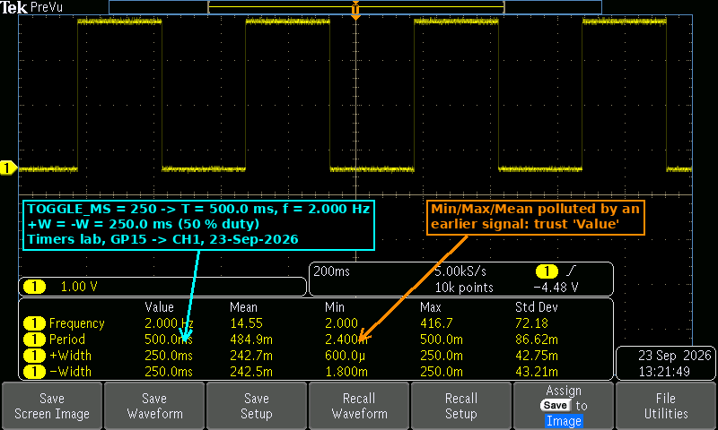
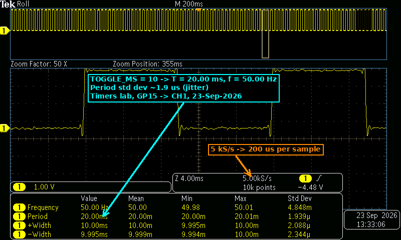
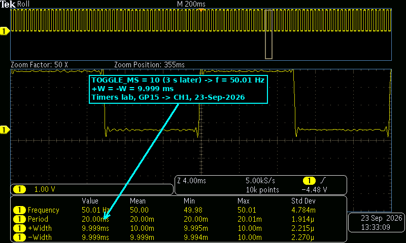

# Timers — Repeating Timer on GP15 (Predict vs Measure)

**Goal (one sentence):** Generate a square wave on GP15 from an SDK repeating timer (no `sleep_ms` in the loop), predict its period, frequency and duty cycle from `TOGGLE_MS`, and check the prediction on the oscilloscope.

---

## Prediction

The callback toggles GP15 once every `TOGGLE_MS`, so one full period is one HIGH plus one LOW:

- `T = 2 · TOGGLE_MS`  `f = 1 / T = 1000 / (2 · TOGGLE_MS)` Hz  duty = 50 % (HIGH and LOW both last `TOGGLE_MS`)
- `TOGGLE_MS = 250` → HIGH = LOW = 250 ms, **T = 500 ms**, **f = 1000 / 500 = 2.000 Hz**
- `TOGGLE_MS = 10` → HIGH = LOW = 10 ms, **T = 20 ms**, **f = 1000 / 20 = 50.00 Hz**

With a negative delay (`-TOGGLE_MS`) the callbacks are scheduled start-to-start, so I expected **no drift**: at most a few µs of jitter from interrupt latency on each edge.

## Setup

- Pin map: GP15 → scope CH1 (timer output); scope ground → a Pico GND pin only. GP14 (CH2 callback marker) was not used in these captures.
- Photo of the breadboard: *not taken this session* (only the Pico and the probe on GP15 / GND).
- Non-default: none. Default 150 MHz `clk_sys`, timer at its default 1 µs tick, no pulls, no external parts. Scope at 5 kS/s, 10k points, trigger on CH1 rising edge.

## What I did

1. Copied the course repeating-timer code, set `OUT_PIN = 15`, `TOGGLE_MS = 250`, `add_repeating_timer_ms(-TOGGLE_MS, …)`.
2. Built and flashed; probed GP15 on CH1, 200 ms/div, added Frequency / Period / +Width / −Width measurements → E1.
3. Changed only `TOGGLE_MS` to `10`, rebuilt and flashed.
4. Zoomed in 50× (4 ms/div) on the 200 ms/div record → E2.
5. Saved a second capture 3 s later to check repeatability → E3.

---

## Evidence

| #  | File | What it shows | Cursor / measured value |
| --- | --- | --- | --- |
| E1 | `img/timers_scope1.png` | `TOGGLE_MS = 250`, four full periods at 200 ms/div | f = 2.000 Hz, T = 500.0 ms, +W = 250.0 ms, −W = 250.0 ms |
| E2 | `img/timers_scope2.png` | `TOGGLE_MS = 10`, 50× zoom (4 ms/div) | f = 50.00 Hz, T = 20.00 ms, +W = 10.00 ms, −W = 9.995 ms, σ(T) = 1.939 µs |
| E3 | `img/timers_scope3.png` | Same as E2, captured 3 s later | f = 50.01 Hz, T = 20.00 ms, +W = 9.999 ms, −W = 9.999 ms, σ(T) = 1.914 µs |







## Predicted vs measured

| Quantity | Predicted | Measured (evidence #) | Error % | Why the difference |
| --- | --- | --- | --- | --- |
| Period, `TOGGLE_MS = 250` | 500 ms | 500.0 ms (E1) | 0.00 % | Real error is µs-level; the 4-digit readout resolves only 0.1 ms |
| Frequency, `TOGGLE_MS = 250` | 2.000 Hz | 2.000 Hz (E1) | 0.00 % | Same as above |
| HIGH / LOW, `TOGGLE_MS = 250` | 250 / 250 ms | 250.0 / 250.0 ms (E1) | 0.00 % | 50 % duty, as expected from a toggle |
| Period, `TOGGLE_MS = 10` | 20 ms | 20.00 ms (E2, E3) | 0.00 % | σ ≈ 1.9 µs is interrupt-latency jitter, far below 10 µs display step |
| Frequency, `TOGGLE_MS = 10` | 50.00 Hz | 50.00 Hz (E2) / 50.01 Hz (E3) | 0.00 % / +0.02 % | Last-digit variation between captures (jitter + scope rounding) |
| LOW time, `TOGGLE_MS = 10` | 10 ms | 9.995 ms (E2) / 9.999 ms (E3) | −0.05 % / −0.01 % | 5 kS/s = 200 µs per sample; the edge position is interpolated, so a few µs of jitter shows up |

**Conclusion:** `T = 2 · t_toggle` and `f = 1 / (2 · t_toggle)` hold for both values; the waveform is a clean 50 % square wave and changing `TOGGLE_MS` is the only thing needed to move the frequency.

## What went wrong

- **"Too perfect" readings — we couldn't see any delay:** we expected something like 500.12 ms or 501 ms (callback/interrupt overhead adding up), but E1 reads exactly **500.0 ms** and E2 exactly **20.00 ms**. At first we thought the scope was "correcting" the value. What we found by looking at the numbers again:
    - The readout has only 4 digits: at 500.0 ms the smallest step is **100 µs**, and at 20.00 ms it is 10 µs. Anything smaller is rounded away.
    - The sampling is 5 kS/s → **200 µs between samples** (see the 5.00 kS/s field annotated in E2), so a few µs of shift on an edge cannot be resolved visually.
    - The actual error *is* tiny: with `-TOGGLE_MS` each deadline is `previous deadline + TOGGLE_MS`, so the ISR latency (a few µs at 150 MHz) causes **jitter, not drift** — it doesn't accumulate. The only place it shows is the **Std Dev** column: σ(T) ≈ 1.9 µs in E2/E3.
    - Fix / how to see it next time: use a faster timebase (e.g. 1–10 µs/div around one edge, ≥ 1 MS/s) and read Std Dev or Min/Max instead of the `Value` column.
- **Polluted statistics in E1:** the Mean/Min/Max columns in E1 show impossible values (Min period 2.4 ms, Max frequency 416.7 Hz, Mean 14.55 Hz) for a 2 Hz signal. Those come from samples taken before the signal was stable (probe being connected / previous program), and the statistics were never reset. We trusted only the `Value` column for E1; next time press *Reset Statistics* after the signal settles.

## Code

```c
#define OUT_PIN    15
#define TOGGLE_MS  250          // only line changed between runs (250 → 10)

static bool toggle_cb(repeating_timer_t *t) {
    level = !level;
    gpio_put(OUT_PIN, level);   // short callback, no sleeps
    return true;                // keep repeating
}

int main(void) {
    ...
    repeating_timer_t timer;
    // negative delay: start-to-start scheduling → jitter but no drift
    add_repeating_timer_ms(-TOGGLE_MS, toggle_cb, NULL, &timer);
    while (true) tight_loop_contents();   // main() is free
}
```

Full file at `src/timers/timers.c`.

## Open question

If the callback had real work in it (e.g. a 20 ms `busy_wait_ms`), how big would the difference between `-100` and `+100` be on the scope? With a positive delay the callback time should add to every period (≈ 120 ms instead of 100 ms per toggle) — that one should be large enough to see even at this scope resolution, unlike the µs-level jitter above. Want to measure it with the GP14 marker on CH2.
