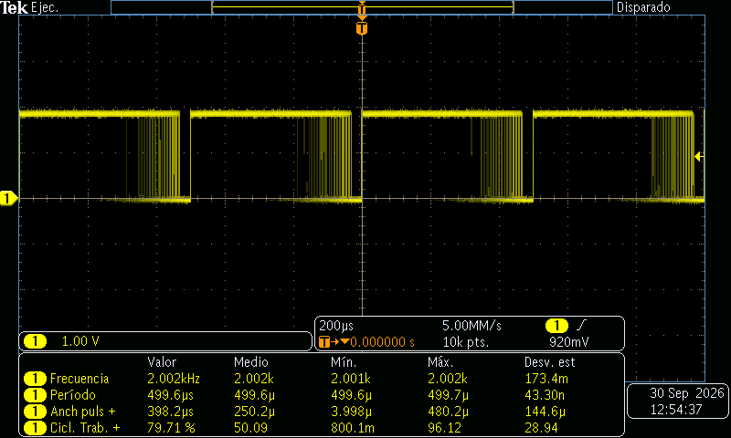
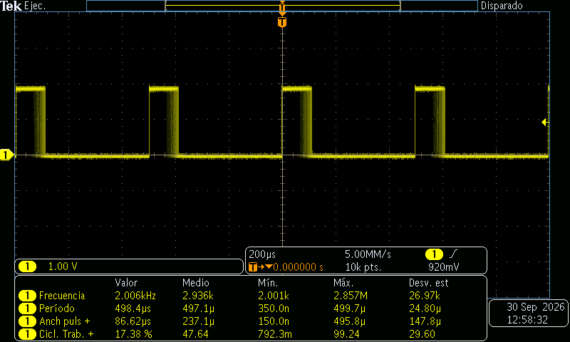
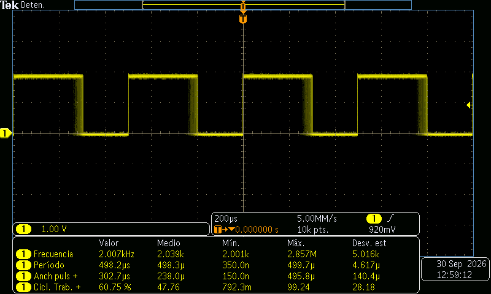
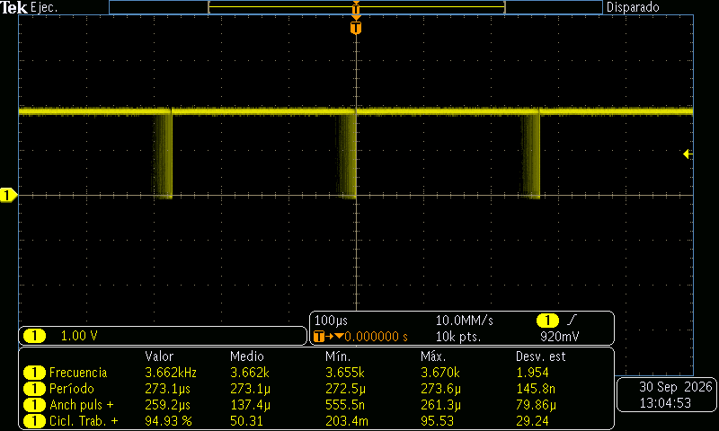
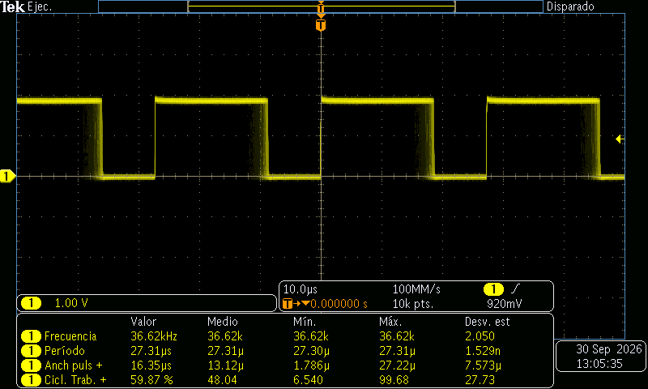
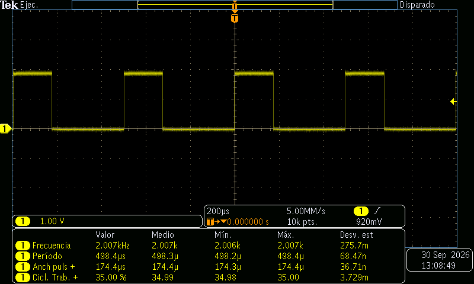
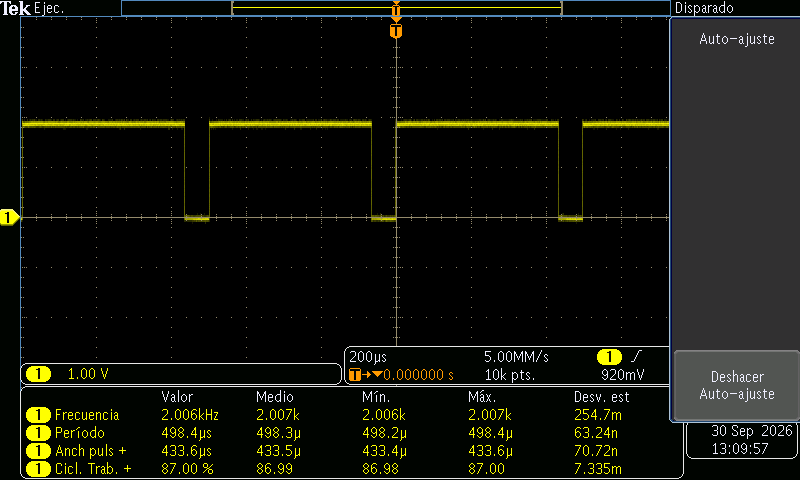
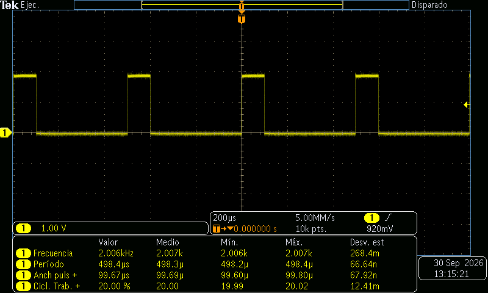
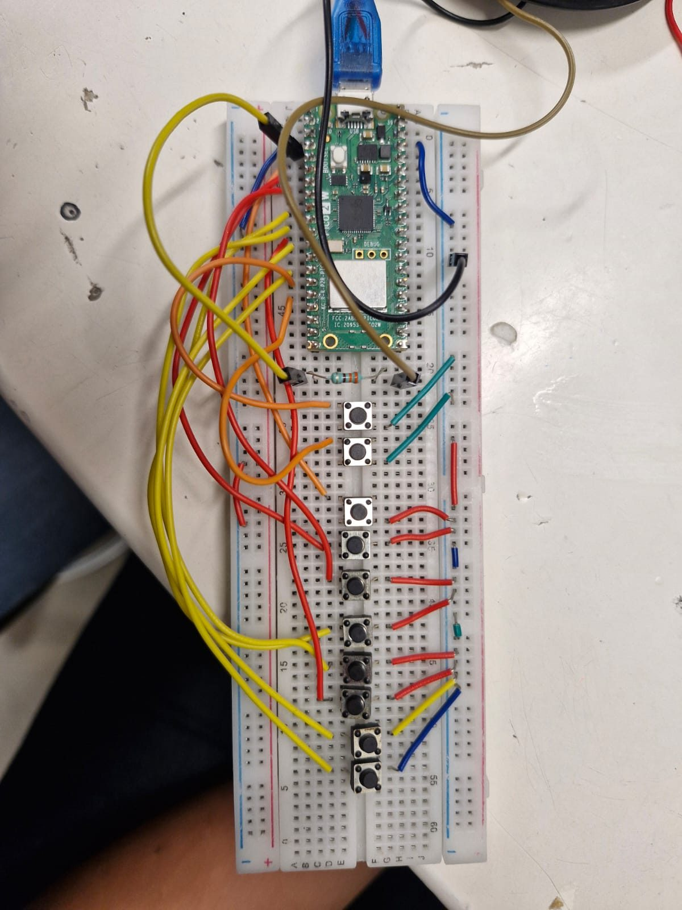

# PWM — LED Fade, Clock Divider and an 8-Key Piano (Predict vs Measure)

**Goal (one sentence):** Predict a PWM signal's frequency and duty from `clk_sys`, the clock divider and `TOP` and check it on the oscilloscope (Part 1, LED), then use the same formula backwards to play notes on a speaker with an 8-key PWM piano (Part 2).

---

# Part 1 — LED Fade, Clock Divider and Fixed Duty

## Prediction

A PWM slice counts `0 … TOP` at `clk_sys / div`, so:

- `f_PWM = f_clk / (div · (TOP + 1))`  `duty = level / (TOP + 1)`  `+W = duty · T`
- **Course example** (`F_PWM_HZ = 2000`, `TOP = 1023`, `f_clk = 150 MHz`): `div = 150 MHz / (2000 · 1024) = 73.24` → **f = 2.000 kHz, T = 500.0 µs**
- **`DIV_10`** (`div = 10`, `TOP = 4095`): `150 MHz / (10 · 4096)` → **f = 3.662 kHz, T = 273.1 µs**
- **`DIV_1`** (`div = 1`, `TOP = 4095`): `150 MHz / (1 · 4096)` → **f = 36.62 kHz, T = 27.31 µs**
- **Fixed duty** at 2 kHz, `TOP = 1023`: 35 % → `+W ≈ 175 µs`, 87 % → `+W ≈ 435 µs`, 20 % → `+W ≈ 100 µs`
- **Fade** (`step = 8`, `sleep_ms(5)`): the level sweeps 0 → TOP → 0 like a triangle, so a random scope snapshot sees a roughly uniform duty between 0 and 100 %: **mean ≈ 50 %**, **σ ≈ 100 / √12 = 28.9 %**. Ramp time ≈ `(TOP / 8) · 5 ms` = 0.64 s for `TOP = 1023` (2.56 s for `TOP = 4095`).

## Setup

- Pin map: `LED_PIN` = GP2 → LED (with series resistor) **and** scope CH1; scope ground → a Pico GND pin.
- Photo of the breadboard: *not taken this session* (Pico 2 W, one LED on GP2, probe on GP2 / GND).
- Non-default: none. Default 150 MHz `clk_sys`. Scope at 5 MS/s (200 µs/div) for the 2 kHz runs, 10 MS/s and 100 MS/s for the faster ones; 10k points, trigger on CH1 rising edge at 920 mV.

## What I did

1. Flashed the course `pwm_led.c` (fade, 2 kHz, `TOP = 1023`) and probed GP2 at 200 µs/div with Frequency / Period / +Width / Duty measurements → E1–E3.
2. Did the divider math by hand with a calculator and left it as an **integer** (`div = 73` instead of 73.24), reflashed and measured again → E2, E3.
3. Changed `TOP` to 4095 and set the divider to 10 (`DIV_10`), then to 1 (`DIV_1`), keeping the fade → E4, E5.
4. Went back to 2 kHz (`TOP = 1023`, `div = 73`), turned the fade off and wrote a fixed level for 35 %, 87 % and 20 % duty → E6–E8.
5. Compared every `Value`/`Mean` reading with the formula above.

---

## Evidence

| #  | File | What it shows | Cursor / measured value |
| --- | --- | --- | --- |
| E1 | `img/pwm_scope1.png` | Course code as-is, fade running (smeared falling edge = changing duty) | f = 2.002 kHz, T = 499.6 µs, duty mean 50.09 %, σ 28.94 %, min +W 3.998 µs |
| E2 | `img/pwm_scope2.png` | Fade, integer divider 73 (calculator value) | f = 2.006 kHz, T = 498.4 µs, duty mean 47.64 %, σ 29.60 % — Min T = 350 ns / Max f = 2.857 MHz (bad stats) |
| E3 | `img/pwm_scope3.png` | Same as E2, acquisition stopped (single frame) | f = 2.007 kHz, T = 498.2 µs, duty 60.75 % (snapshot), mean 47.76 %, σ 28.18 % |
| E4 | `img/pwm_scope4.png` | `DIV_10`, `TOP = 4095`, fade, 100 µs/div | f = 3.662 kHz, T = 273.1 µs, mean 50.31 %, σ 29.24 % |
| E5 | `img/pwm_scope5.png` | `DIV_1`, `TOP = 4095`, fade, 10 µs/div | f = 36.62 kHz, T = 27.31 µs, mean 48.04 %, σ 27.73 % |
| E6 | `img/pwm_scope6.png` | Fixed duty 35 % | f = 2.007 kHz, T = 498.4 µs, +W = 174.4 µs, duty = 35.00 % |
| E7 | `img/pwm_scope7.png` | Fixed duty 87 % | f = 2.006 kHz, T = 498.4 µs, +W = 433.6 µs, duty = 87.00 % |
| E8 | `img/pwm_scope8.png` | Fixed duty 20 % | f = 2.006 kHz, T = 498.4 µs, +W = 99.67 µs, duty = 20.00 % |

















## Predicted vs measured

| Quantity | Predicted | Measured (evidence #) | Error % | Why the difference |
| --- | --- | --- | --- | --- |
| f, course code (div 73.24) | 2.000 kHz | 2.002 kHz (E1) | +0.10 % | Divider is stored as 8.4 fixed point: 73.24 → 73 + 3/16 = 73.1875 → 2.0015 kHz |
| T, course code | 500.0 µs | 499.6 µs (E1) | −0.08 % | Same as above (73.1875 · 1024 / 150 MHz = 499.6 µs) |
| f, 2 kHz runs E2–E8 (`div = 73`) | 2.000 kHz (target) / 2.0066 kHz (with div 73) | 2.006–2.007 kHz | +0.33 % vs target / 0.00 % vs div 73 | We rounded 73.24 down to the integer 73 by hand: 150 MHz / (73 · 1024) = 2.0066 kHz |
| f, `DIV_10` | 3.662 kHz | 3.662 kHz (E4) | 0.00 % | Integer divider, exact |
| f, `DIV_1` | 36.62 kHz | 36.62 kHz (E5) | 0.00 % | Integer divider, exact |
| T, `DIV_1` | 27.31 µs | 27.31 µs (E5) | 0.00 % | σ(T) = 1.5 ns → crystal-locked, no jitter like the timer callback |
| +W at 35 % | 174.2 µs (level 358, div 73) | 174.4 µs (E6) | +0.1 % | 1 sample = 200 ns at 5 MS/s; level 358/1024 = 34.96 % |
| +W at 87 % | 433.6 µs (level 891, div 73) | 433.6 µs (E7) | 0.00 % | 891/1024 = 87.01 % |
| +W at 20 % | 99.77 µs (level 205, div 73) | 99.67 µs (E8) | −0.1 % | Half a sample; edge interpolation |
| Fade: mean duty | 50 % | 47.6–50.3 % (E1–E5) | ≤ −4.7 % | Finite number of captures of a triangle; it settles near 50 % the longer it runs |
| Fade: σ duty | 28.9 % | 27.7–29.6 % (E1–E5) | ±4 % | Same; a uniform 0–100 % distribution has σ = 28.87 % |
| Fade: min +W | 3.89 µs (level 8, first step) | 3.998 µs (E1) | +2.7 % | First non-zero level is `step = 8`; ~1 sample of rounding |

**Conclusion:** `f = f_clk / (div · (TOP + 1))` predicted every frequency to within the divider's fractional resolution, and `duty = level / (TOP + 1)` gave the fixed duties to within one scope sample. Lowering the divider ×10 multiplies the frequency ×10 (E4 → E5) without changing the duty behavior; `TOP` trades frequency for resolution.

## What went wrong

- **2.002 / 2.007 kHz instead of 2.000 kHz:** the prediction said exactly 2 kHz, but E1 reads 2.002 kHz and the later runs 2.006–2.007 kHz. Two causes, both in the divider:
    - With the course float (E1): the RP2350 stores the divider as 8 integer + 4 fractional bits (steps of 1/16), and `pwm_set_clkdiv()` **truncates** the float, so 73.24 becomes 73.1875 → 2001.5 Hz.
    - With our calculator value (E2–E8): we did the math by hand and left the divider as the integer **73**, dropping the 0.24 → 150 MHz / (73 · 1024) = 2006.6 Hz, i.e. +0.33 %. The scope matched the divider we actually wrote, not the 2 kHz we wanted.
    - Fix: pick `TOP` and `div` so the divider is exact — e.g. `TOP = 999`, `div = 75` → 150 MHz / (75 · 1000) = **exactly 2000 Hz** — or compute the real frequency from the stored divider instead of the requested one.
- **Polluted statistics:** E2/E3 show Min period = 350 ns and Max frequency = 2.857 MHz, which are impossible for a 2 kHz PWM. They came from glitches while reflashing / reconnecting the probe, and the statistics were never reset. We trusted only the `Value` and `Mean` columns; next time press *Reset Statistics* after the signal settles.
- **"Value" duty means nothing during the fade:** E1–E5 show duties of 17 %, 60 %, 79 %, 95 %… depending on when the snapshot was taken. For the fade, the useful numbers are Mean (≈ 50 %) and Std Dev (≈ 28.9 %), not `Value`.

## Code

```c
#define TOP       1023                              // 10-bit (4095 for DIV_10 / DIV_1)
float div = 150000000.0f / (F_PWM_HZ * (TOP + 1)); // 73.24 ...
pwm_set_clkdiv(slice, div);   // E1: HW keeps 73 + 3/16 -> 2.0015 kHz, not 2.000
pwm_set_clkdiv(slice, 73.0f); // E2-E8: calculator value, integer -> 2.0066 kHz
pwm_set_wrap(slice, TOP);

// exact 2 kHz alternative:  pwm_set_wrap(slice, 999); pwm_set_clkdiv(slice, 75.0f);

// fixed duty: level = round(DUTY_PCT * (TOP + 1) / 100)  -> 20 % = 205
pwm_set_chan_level(slice, chan, level);
pwm_set_enabled(slice, true);
```

Full file at `src/pwm/pwm_led.c` (reconstructed from the course `pwm_led.c` after the session with the integer dividers we used; the exact lab file was not saved).

---

# Part 2 — 8-Key PWM Piano

## Divider per note

Same formula as Part 1, solved for the divider: `div = f_clk / (f_note · (TOP + 1))`, with `f_clk = clock_get_hz(clk_sys)` = 150 MHz and `TOP = 1023`. The hardware keeps the divider in steps of 1/16, so the note that comes out is `150 MHz / (⌊16·div⌋/16 · 1024)`:

| Key (GPIO) | Note | `NOTAS[i]` | div (float) | div stored (1/16) | f output |
| --- | --- | --- | --- | --- | --- |
| GP3  | C6 | 1046 Hz | 140.042 | 140.0000 | 1046.3 Hz |
| GP4  | D6 | 1175 Hz | 124.668 | 124.6250 | 1175.4 Hz |
| GP5  | E6 | 1318 Hz | 111.141 | 111.1250 | 1318.2 Hz |
| GP6  | F6 | 1397 Hz | 104.856 | 104.8125 | 1397.6 Hz |
| GP7  | G6 | 1568 Hz |  93.421 |  93.3750 | 1568.8 Hz |
| GP8  | A6 | 1760 Hz |  83.230 |  83.1875 | 1760.9 Hz |
| GP9  | B6 | 1975 Hz |  74.169 |  74.1250 | 1976.2 Hz |
| GP10 | C7 | 2093 Hz |  69.988 |  69.9375 | 2094.5 Hz |

Every note stays within **+0.07 %** of the target, much less than the ≈ 0.3 % (5 cents) an ear can notice. Duty starts at 50 % (`level = 512`), the square wave with the strongest fundamental.

## Setup

- Pin map: GP2 (`BUZZER_PIN`) → series resistor → speaker (+), speaker (−) → GND; GP3–GP10 → 8 note buttons (C6 … C7); GP11 → `BTN_UP`, GP12 → `BTN_DOWN` (level ± 64).
- Photo of the breadboard: 
- Non-default: internal pull-ups on GP3–GP12 (`gpio_pull_up`), so every button is active-low; buttons read straight from `sio_hw->gpio_in`. The divider is a **float** computed from `clock_get_hz(clk_sys)`, not an integer typed in by hand.

## What I did

1. Wired 8 note buttons on GP3–GP10, two level buttons on GP11/GP12, and the speaker through a resistor on GP2.
2. Wrote `piano.c`: `TOP = 1023` fixed, a table `NOTAS[8]`, and in the loop the first pressed key sets `pwm_set_clkdiv(slice, f_clk / (NOTAS[i] · 1024))` and enables the slice; no key → slice disabled (silence).
3. Added `BTN_UP` / `BTN_DOWN` to move the channel level in steps of 64 (6.25 % duty), clamped to 0 … TOP.
4. Flashed it, played a few melodies across all 8 keys and recorded it with sound: `img/pwm_piano_demo.mp4`.

## Evidence

| #  | File | What it shows | Observation |
| --- | --- | --- | --- |
| E9  | `img/pwm_piano_demo.mp4` | Playing the piano, all 8 keys used (C6 at 0 s, D6/F6 at ~3.5 s, G6 at ~5.5 s, C7 at ~10 s, B6/A6 at ~12–15 s) | Each key gives a different steady tone; silence between presses |

<video controls width="100%" src="../../img/pwm_piano_demo.mp4"></video>

## What went wrong

- **One key at a time:** pressing two keys plays only the lower one, because the `for` loop `break`s on the first pressed key and a slice can only produce one frequency. A chord would need a second slice/pin.
- **`sleep_ms(150)` in the volume buttons blocks the keys:** while `BTN_UP`/`BTN_DOWN` is held, the loop only runs every ~155 ms, so the note keys respond late. It's acceptable for a demo; a timer/IRQ-based debounce (like Session 8) would fix it.
- **The "volume" buttons don't really change volume linearly:** they change the duty. The loudest fundamental is at 50 % (`level = 512`); moving up *or* down from there makes the tone quieter and thinner, and at 0 % or 100 % (level 0 / TOP) there is no sound at all.

## Code (piano)

```c
#define TOP 1023
const uint32_t NOTAS[8] = {1046, 1175, 1318, 1397, 1568, 1760, 1975, 2093};

float f_clk = (float)clock_get_hz(clk_sys);        // 150 MHz, not hard-coded
pwm_set_wrap(slice, TOP);
int level = (TOP + 1) / 2;                          // 50 % = strongest fundamental

for (int i = 0; i < 8; i++) {
    if ((sio_hw->gpio_in & (1u << (BTN_BASE + i))) == 0) {        // active-low key
        float div = f_clk / ((float)NOTAS[i] * (float)(TOP + 1)); // keep the fraction!
        pwm_set_clkdiv(slice, div);
        pwm_set_enabled(slice, true);
        note_pressed = true;
        break;                                       // one note at a time
    }
}
if (!note_pressed) pwm_set_enabled(slice, false);   // silence
```

Full file at `src/pwm/piano.c`.

---

## Open question

At 2 kHz the LED looked steady, but would a phone camera show banding (the notes recommend 10–20 kHz)? Next time: compare 2 kHz vs `DIV_1` (36.6 kHz) on camera, and try `pwm_set_phase_correct(slice, true)` — it should halve the frequency (count up *and* down) and, per the notes, cancel the even harmonics, which I'd like to see with the scope's FFT.
