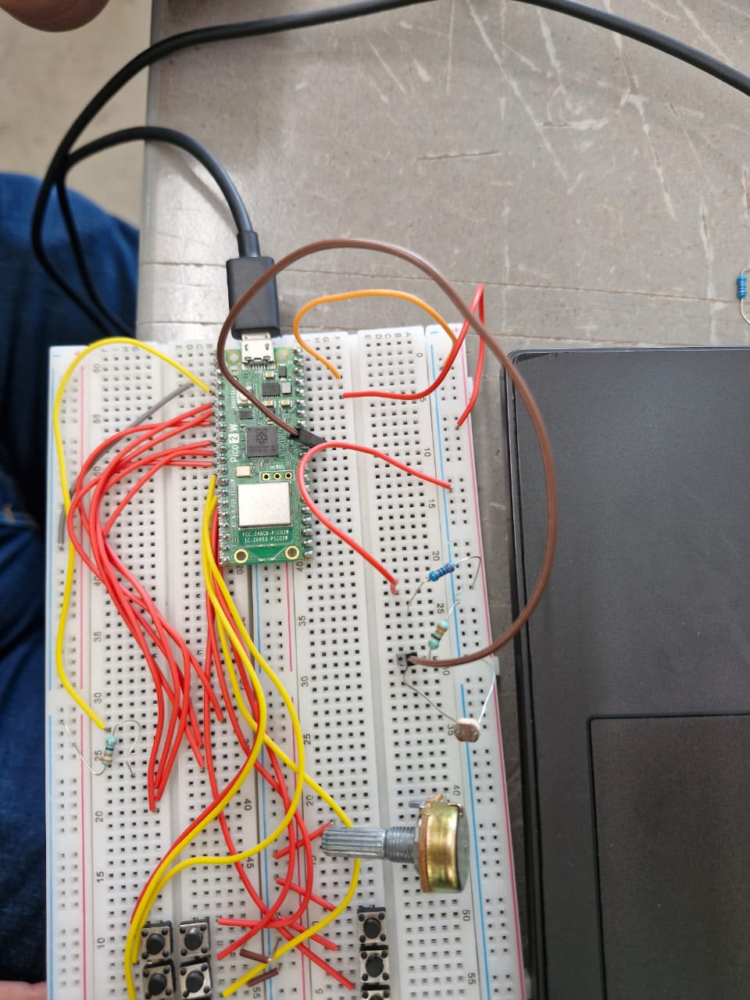
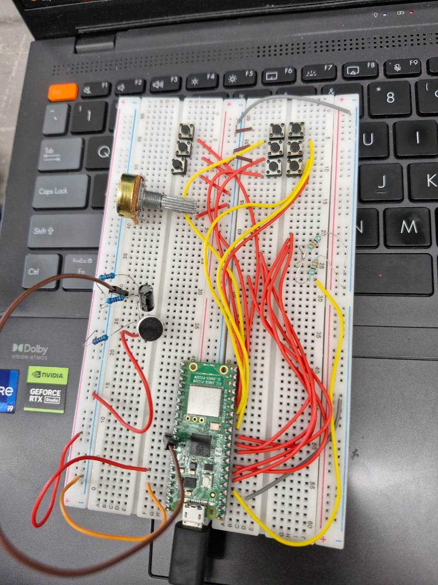
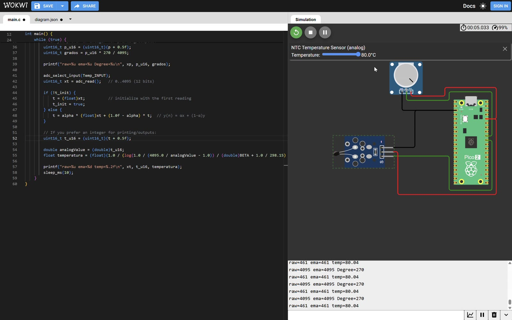

# ADC — LDR, Electret Noise Detector, Potentiometer Angle and NTC Temperature

**Goal (one sentence):** Read analog sensors with the RP2350 ADC: an LDR (EMA-filtered, converted to volts and a 0–100 % light level) and an electret microphone (fixed-threshold noise detector) on ADC0, plus a potentiometer (ADC1 → 0–270°) and an NTC thermistor (ADC0 → °C with the Beta equation) read together by switching channels.

---

## Setup

- Pin map: `LDR_GPIO_PIN` = GP26 → `LDR_ADC_INPUT` = ADC0. The same pin/channel is used for the electret (one sensor at a time, separate programs).
- **LDR:** voltage divider between 3.3 V and GND, midpoint to GP26. The reading **goes up with light**, so the LDR is on the 3.3 V side and the fixed resistor on the GND side.
  
- **Electret:** electret capsule with its bias resistor, a coupling capacitor and a resistor divider that centers the signal around mid-supply before GP26.
  
- **Potentiometer + NTC (Wokwi simulation):** potentiometer wiper → GP27 (ADC1), NTC temperature module (analog out) → GP26 (ADC0), both powered from 3.3 V / GND of the Pico 2. The temperature is set with the sensor's slider in the simulator.
  
- Non-default: none. `adc_gpio_init(26)` disables the digital input buffer and pulls on the pin; ADC in free single-shot mode (`adc_read()`), default 150 MHz `clk_sys`. USB serial monitor at 115200 baud.

## What I did

1. Initialized the ADC (`adc_init`, `adc_gpio_init(26)`, `adc_select_input(0)`) and printed raw values to find the dark/bright extremes of the LDR → used them as `LDR_MIN = 9` and `LDR_MAX = 3600`.
2. Added the EMA filter from the course notes (`α = 0.0625`), seeded with the first sample so it doesn't start from 0.
3. Converted the filtered value to volts and to a percentage, and printed `Raw | Filtro | Voltaje | Nivel` every 100 ms.
4. Recorded a demo: hands covering the LDR, then uncovered (room light), then a phone flashlight on top and moving away → `img/adc_ldr_demo.mp4` (audio removed).
5. Swapped the LDR for the electret front end and flashed `adcmicrosencillo.c`, which prints the raw value every 100 ms and labels it "Ruido alto" when `raw > 2110`, otherwise "Ruido normal".
6. Wrote `pot_temp.c` in Wokwi: each loop selects ADC1 (pot) and then ADC0 (NTC) with `adc_select_input`, applies a separate EMA to each, maps the pot to `grados = ema · 270 / 4095`, and converts the NTC reading to °C with the Beta equation (`β = 3950`, `T0 = 25 °C`). Loop every 10 ms.
7. Moved the NTC slider (18.8 → 80 → −24 °C) and turned the pot across its range while recording the serial output → `img/adc_pot_temp_demo.mp4`.

---

## Evidence

| #  | File | What it shows | Reading on the serial monitor |
| --- | --- | --- | --- |
| E1 | `img/adc_ldr_demo.mp4` | ~0:00–0:04: LDR covered with both hands | Raw = 37, Filtro = 37, 0.03 V, Nivel = 0 % |
| E2 | `img/adc_ldr_demo.mp4` | ~0:06: hands removed, room light | Raw ≈ 782–787, **Filtro ≈ 488–489**, 0.39–0.40 V, Nivel = 13 % (filter still climbing) |
| E3 | `img/adc_ldr_demo.mp4` | ~0:09: light increasing | Raw = 799–1028, Filtro = 742–765, 0.60 V, Nivel = 20 % |
| E4 | `img/adc_ldr_demo.mp4` | ~0:12: flashlight on the LDR | **Raw = 3039 / 2906, Filtro = 2397 / 2429**, 1.93–1.96 V, Nivel = 66–67 % |
| E5 | `img/adc_ldr_demo.mp4` | ~0:15: flashlight moving away | **Raw = 1072, Filtro = 2653**, 2.14 V, Nivel = 73 % (filter still high) |

<video controls muted width="100%" src="../../img/adc_ldr_demo.mp4"></video>

Spot-check of the conversion with E4: `2397 · 3.3 / 4095 = 1.93 V` ✔ and `(2429 − 9) · 100 / 3591 = 67 %` ✔ — the printed values match the formulas.

**Potentiometer + NTC (Wokwi):**

| #  | File | What it shows | Reading on the serial monitor |
| --- | --- | --- | --- |
| E6 | `img/adc_pot_temp_demo.mp4` | ~0:01: NTC at its default 24 °C, pot fully turned | temp: raw = 2093 → **24.00 °C**; pot: raw = 4095 → Degree = 270 |
| E7 | `img/adc_pot_temp_demo.mp4` | ~0:03: NTC slider at 80.0 °C | raw = 461 → **80.04 °C** |
| E8 | `img/adc_pot_temp_demo.mp4` | ~0:05: slider dropped to −24.0 °C | raw = 3813, ema = 3734 → 3744 → −19.70 / −20.20 °C (EMA still settling) |
| E9 | `img/adc_pot_temp_demo.mp4` | ~0:08: settled at −24.0 °C, pot near the middle | raw = 3813 → **−23.98 °C**; pot: raw = 1941, ema = 1949 → Degree = 128 |
| E10 | `img/adc_pot_temp_demo.mp4` | ~0:11: pot turned to the minimum | raw = 0, ema = 368 → 345 → 323, Degree = 24 → 22 → 21 (EMA catching up) |
| E11 | `img/adc_pot_temp_demo.mp4` | ~0:14 and ~0:17: pot at two other positions | raw = 1533 → Degree = 101; raw = 4078 → Degree = 268 |

<video controls muted width="100%" src="../../img/adc_pot_temp_demo.mp4"></video>

The NTC reading follows the simulator slider within ~0.05 °C once the EMA settles (E6, E7, E9), and the pot angle checks out: `1949 · 270 / 4095 = 128.5 → 128°` ✔. Hotter NTC → lower raw value (E7 vs E8), so the NTC is on the low side of its divider.

## What went wrong

- **Wiring error on the temperature sensor:** we made a mistake when connecting the temperature sensor, so it did not give a valid reading at first and we had to recheck the wiring before it worked.
- **No instrumented electret, so only a simple noise detector:** we didn't buy the electret module with its own amplifier, so we only had the bare capsule with a basic bias/divider front end. Its signal is small, so instead of actually measuring sound level we built a simple noise detector: one raw sample compared against a fixed threshold (`2110`, ≈ 1.70 V) that prints "Ruido alto" / "Ruido normal".
- **Calibrating the potentiometer reading took some effort:** getting the potentiometer measurement to map correctly to its full range took several tries until the raw range 0–4095 matched the actual value of the potentiometer.

## Code

```c
// LDR — EMA filter + conversion (Fotorresistencia.c)
uint16_t x = adc_read();                       // 0..4095
if (!y_init) { y = (float)x; y_init = true; }  // seed with first sample
else          y = alpha * (float)x + (1.0f - alpha) * y;   // alpha = 1/16

uint16_t y_u16 = (uint16_t)(y + 0.5f);
float voltaje  = (y_u16 * 3.3f) / 4095.0f;
int porcentaje = ((y_u16 - LDR_MIN) * 100) / (LDR_MAX - LDR_MIN);

// Electret — fixed threshold (adcmicrosencillo.c)
uint16_t m = adc_read();
if (m > 2110) printf("Raw=%u | Ruido alto\n", m);    // ~1.70 V, ~62 LSB above mid-scale
else          printf("Raw=%u | Ruido normal\n", m);
sleep_ms(100);

// Potentiometer + NTC — two channels in the same loop (pot_temp.c)
adc_select_input(Pot_INPUT);                  // ADC1 -> GP27
uint16_t xp = adc_read();
p = alpha * (float)xp + (1.0f - alpha) * p;
uint16_t grados = (uint16_t)(p + 0.5f) * 270 / 4095;

adc_select_input(Temp_INPUT);                 // ADC0 -> GP26
uint16_t xt = adc_read();
t = alpha * (float)xt + (1.0f - alpha) * t;
double a = (double)(uint16_t)(t + 0.5f);
float temperatura = (float)(1.0 / (log(1.0 / (4095.0 / a - 1.0)) / BETA
                    + 1.0 / 298.15) - 273.15);  // Beta equation, T0 = 25 °C
```

Full files at `src/adc/Fotorresistencia.c`, `src/adc/adcmicrosencillo.c` and `src/adc/pot_temp.c`.

## Open question

For the electret, a single sample every 100 ms can't really "hear" anything. Next session I want to sample fast (e.g. ~8–10 kHz with a tight loop or the ADC FIFO / free-running mode), compute the **peak-to-peak or RMS over a 100 ms window** around the 2048 bias, and compare *that* against a threshold. I'd also like to check the actual bias point of my front end — if it's not close to 2048, a fixed `2110` threshold could be almost always "alto" or never "alto" depending on the resistors.
