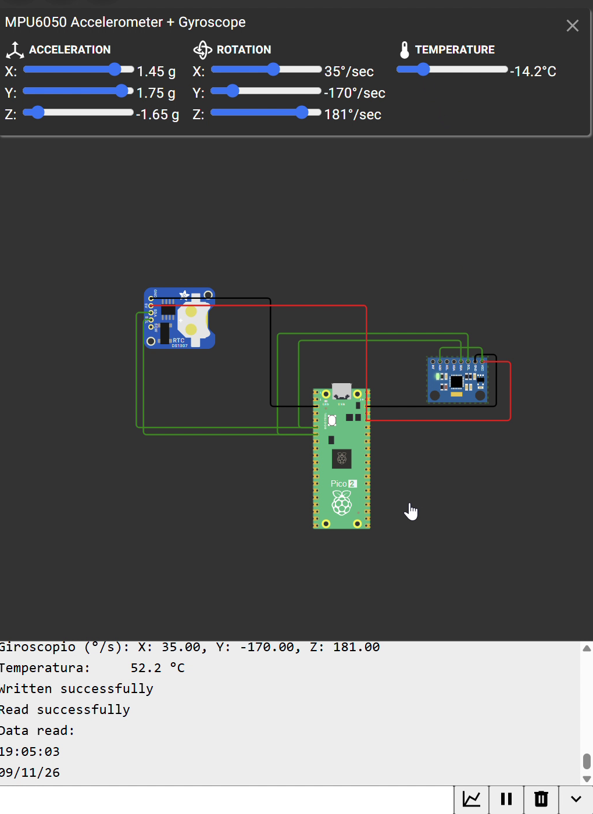

# I2C — Reading a DS1307 RTC and an MPU6050 on the Same Bus (Wokwi)

**Goal (one sentence):** Use `i2c0` of the Pico 2 as a master to read the time/date from a DS1307 RTC and the accelerometer, gyroscope and temperature from an MPU6050 — two slaves sharing the same SDA/SCL lines — using the *write register pointer + repeated START + read* sequence, and print the decoded values over USB serial.

---

## Setup

- Pin map: `SDA_PIN`=GP4 (I2C0 SDA), `SCL_PIN`=GP5 (I2C0 SCL), both shared by the two slaves. DS1307 RTC at **`0x68`**, MPU6050 at **`0x69`** (its `AD0` pin tied high). Both modules powered from the Pico's 3V3 and GND.
- Screenshot of the Wokwi circuit: 
- Non-default: simulated in **Wokwi** (no physical board). `i2c0` at **100 kHz** (standard mode). Internal pull-ups enabled on SDA and SCL (`gpio_pull_up`) instead of external resistors. MPU6050 left at its default ranges: ±2 g (16384 LSB/g) and ±250 °/s (131 LSB/(°/s)). Default 150 MHz `clk_sys`, nothing else changed.

## What I did

1. Placed the Pico 2, a DS1307 and an MPU6050 in Wokwi and wired both modules to the same SDA (GP4) / SCL (GP5) lines; tied the MPU6050's `AD0` to VCC so it answers at `0x69` instead of `0x68`.
2. Initialized `i2c0` at 100 kHz, set GP4/GP5 to `GPIO_FUNC_I2C` and enabled their pull-ups.
3. RTC: `i2c_write_blocking` of register `0x00` with `nostop=true`, then `i2c_read_blocking` of 7 bytes (repeated START) → printed `HH:MM:SS` and `DD/MM/YY` directly in hex, since the DS1307 stores them in BCD.
4. MPU6050: same sequence starting at register `0x3B` (`ACCEL_XOUT_H`) and reading 14 bytes; rebuilt each `int16_t` as `(high << 8) | low` and converted to g, °/s and °C (`temp/340 + 36.53`).
5. Ran the simulation, moved the MPU6050 sliders and recorded the screen (audio removed): `img/i2c_wokwi_demo.mp4`.

---

## Evidence

| #  | File | What it shows | |
| --- | --- | --- | --- |
| E1 | `img/i2c_wokwi_demo.mp4` | ~0:03 → ~0:09: the RTC lines go from `19:04:59` to `19:05:05` with date `09/11/26`, printing every 2 s (1 s after the RTC read + 1 s after the MPU read) | The 7-byte read from `0x68` works and the BCD can be printed straight as `%02X` |
| E2 | `img/i2c_wokwi_demo.mp4` | ~0:00–0:04: sliders at Y = −1.4 g, gyro Y = 152 °/s, Z = 19 °/s, 52.2 °C → terminal prints `Y: -1.40`, `Y: 152.00, Z: 19.00`, `52.2 °C` | The 14-byte burst from `0x69` and the conversion formulas are correct |
| E3 | `img/i2c_wokwi_demo.mp4` | ~0:09–0:14: after moving the sliders to Y = 1.75 g, Z = −1.65 g, gyro Y = −170 °/s, Z = 181 °/s, −14.2 °C, the next print shows exactly those values (signs included) | Negative values survive the `int16_t` cast, and both slaves keep answering on the same bus |

<video controls muted width="100%" src="../../img/i2c_wokwi_demo.mp4"></video>

## What went wrong

- **Two slaves at the same address:** the DS1307 has a fixed address of `0x68`, and the MPU6050's default address is also `0x68` (`AD0` = 0). With both on the bus at `0x68`, a read can't tell which device is answering. Fix: tie the MPU6050's `AD0` pin high, which moves it to `0x69`, and use `MPU_ADDR 0x69` in the code.
- **Copy-paste in the MPU error branches:** the MPU block was copied from the RTC block, and its error `printf`s still printed `w` and `r` (the RTC's return values) instead of `w2` and `r2`. It never showed up in the demo because both devices always ACK in Wokwi, but if the MPU failed, the message would report the RTC's result and hide the real error code. Fix: use `w2` / `r2` in those `printf`s (corrected in `src/i2c/i2c.c`).

## Code

```c
#define RTC_ADDR 0x68   // DS1307 (fixed)
#define MPU_ADDR 0x69   // MPU6050 with AD0 = 1, so it doesn't collide with the RTC
...
// START + addr|W + reg 0x3B, no STOP → REPEATED START + addr|R + 14 bytes + NACK + STOP
int w2 = i2c_write_blocking(I2C_PORT, MPU_ADDR, &regmpu, 1, /*nostop=*/true);
if (w2 < 0) { printf("I2C error (ret=%d)\n", w2); goto next2; }   // was `w`
int r2 = i2c_read_blocking(I2C_PORT, MPU_ADDR, memory2, sizeof(memory2), /*nostop=*/false);
...
int16_t accel_y_raw = (memory2[2] << 8) | memory2[3];   // big-endian: high byte first
int16_t temp_raw    = (memory2[6] << 8) | memory2[7];
float accel_y     = accel_y_raw / 16384.0;              // ±2 g
float temperatura = (temp_raw / 340.0) + 36.53;         // datasheet formula
...
// RTC registers are BCD, so %02X prints them as decimal digits
printf("%02X:%02X:%02X \n", memory[2], memory[1], memory[0]);
```

Full file at `src/i2c/i2c.c`.

## Open question

On a real MPU6050, register `PWR_MGMT_1` (`0x6B`) powers up with the `SLEEP` bit set, so reading `0x3B` without first writing `0x00` to `0x6B` should return all zeros — yet in Wokwi the values came out correct without that write. Next time I want to try it on real hardware to see whether the wake-up write is needed, and also print the raw `memory[0]` of the DS1307 to check the `CH` (clock halt) bit 7, which my `%02X` print of the seconds would show as `80`+ if the oscillator were stopped.
