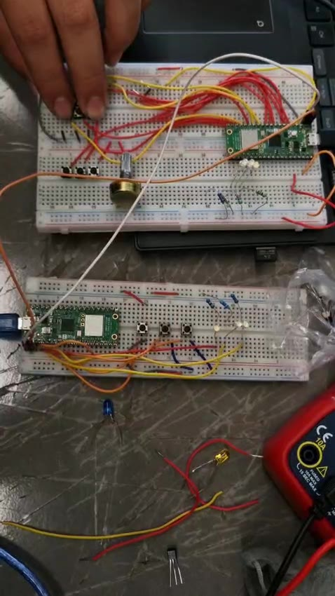

# UART — Two-Pico Button/LED Mirror

**Goal (one sentence):** Connect two Pico 2 boards through UART0 so that pressing a button on one board turns on the matching LED on the other board, and releasing it turns that LED off — in both directions, with the same firmware on both boards.

---

## Setup

- Pin map (identical on both boards): `TX_PIN`=GP0 (UART0 TX), `RX_PIN`=GP1 (UART0 RX); `Button_A`=GP12, `Button_B`=GP13, `Button_C`=GP14; `Led_A`=GP16, `Led_B`=GP17, `Led_C`=GP18 (each LED with its series resistor).
- Board-to-board wiring: GP0 (TX) of board 1 → GP1 (RX) of board 2, GP0 (TX) of board 2 → GP1 (RX) of board 1, and a shared GND between both breadboards.
- Photo of the setup: 
- Non-default: internal pull-ups on the three buttons (`gpio_pull_up`), so a press reads **0**. UART0 configured as 115200 baud, 8 data bits, 1 stop bit, no parity (`uart_set_format(UART_ID, 8, 1, UART_PARITY_NONE)`). Default 150 MHz `clk_sys`, nothing else changed.

## What I did

1. Wired 3 buttons (GP12–GP14) and 3 LEDs (GP16–GP18) on each breadboard, then crossed TX/RX between the two Picos and joined their grounds.
2. Configured GP0/GP1 as `GPIO_FUNC_UART` and initialized `uart0` at 115200 8N1.
3. Defined a tiny protocol of one character per event: uppercase (`'A'`, `'B'`, `'C'`) = button pressed → LED on; lowercase (`'a'`, `'b'`, `'c'`) = button released → LED off.
4. Used one flag per button so each letter is sent **only once** per press/release edge, and on the receive side read every byte available with `while (uart_is_readable(...))`, acting only on those six letters.
5. Flashed the same program to both boards, tested every button in both directions and recorded a short demo (audio removed): `img/uart_demo.mp4`.

---

## Evidence

| #  | File | What it shows | |
| --- | --- | --- | --- |
| E1 | `img/uart_demo.mp4` | ~0:01–0:04: a button is pressed on the bottom board and the LED on the top board turns on while the button is held | Board 2 → Board 1 direction works |
| E2 | `img/uart_demo.mp4` | ~0:05–0:09: a button is pressed on the top board and the matching LED on the bottom board turns on, then turns off on release | Board 1 → Board 2 direction works, and the release (lowercase letter) turns it off |

<video controls muted width="100%" src="../../img/uart_demo.mp4"></video>

## What went wrong

- **Letters sent over and over:** the first version did `if (gpio_get(Button_A) == 0) uart_putc(UART_ID, 'A');` inside the loop, so as long as the button was held it kept sending `'A'` every 10 ms — the other board received a continuous stream instead of one event. Fix: add `flag_a` / `flag_b` / `flag_c` so the letter is sent only on the **edge** (when the button goes from released to pressed) and a lowercase letter only when it goes back.
- **LEDs turning off by themselves (`else` on the receiver):** in that first version I only sent uppercase letters to turn LEDs on, and the receiver did `if (c == 'A') gpio_put(Led_A, 1); else gpio_put(Led_A, 0);`. On the terminal it looked like only my letters were arriving, but there were "gaps" where something else was received that didn't show (non-printable characters such as `\r`/`\n`, or simply the letter of a *different* button). Any byte that wasn't `'A'` fell into the `else` and turned LED A off, even though I was still holding the button. Fix: send an explicit **off** command (`'a'`, `'b'`, `'c'`) on release and remove the generic `else` — now each LED only changes when its own two letters arrive, and any other byte is ignored.

## Code

```c
// --- SEND: only on edges (flag), not every loop iteration ---
if (gpio_get(Button_A) == 0 && flag_a == 0) {
    uart_putc(UART_ID, 'A');      // pressed
    flag_a = 1;
} else if (gpio_get(Button_A) == 1 && flag_a == 1) {
    uart_putc(UART_ID, 'a');      // released
    flag_a = 0;
}
...
// --- RECEIVE: only react to our own letters, no generic else ---
while (uart_is_readable(UART_ID)) {
    char c = uart_getc(UART_ID);
    if (c == 'A')      gpio_put(Led_A, 1);
    else if (c == 'a') gpio_put(Led_A, 0);   // any other byte is ignored
    ...
}
sleep_ms(10);
```

Full file at `src/uart/uart.c`.

## Open question

The receiver uses polling with `sleep_ms(10)` between checks. At 115200 baud one character takes ~87 µs, so in those 10 ms about 115 characters could arrive, but the RX FIFO only holds 16. With three buttons sending single letters this shouldn't fill up, but if the other board sent a burst (for example a full text string) bytes would be lost to an overrun. Next session I want to switch the receive side to the UART RX interrupt with a circular buffer (as in the course example) and check the `OE` (overrun) flag in the RSR register to see whether polling actually drops anything.
